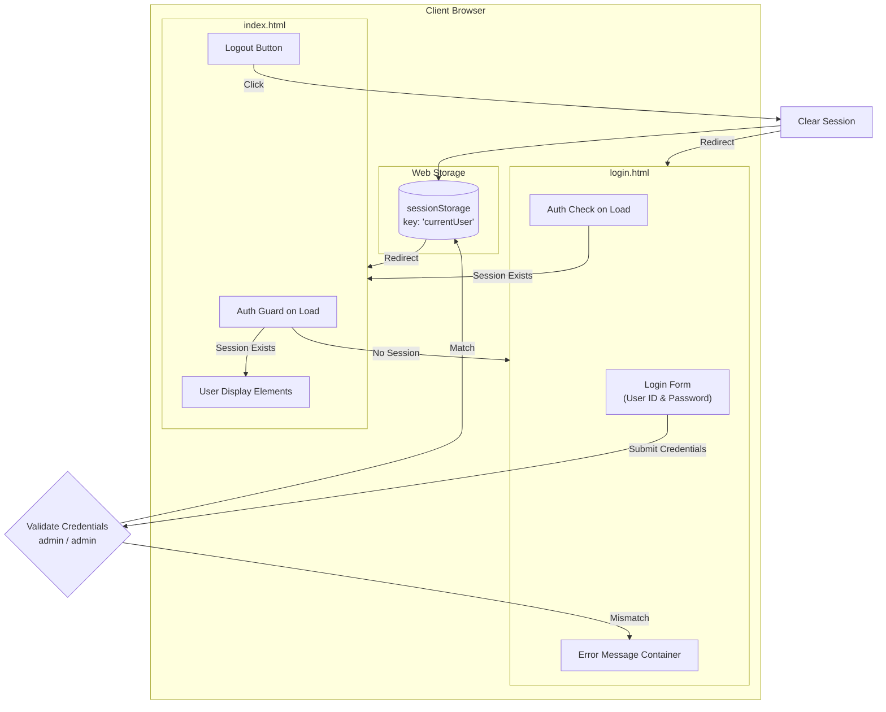
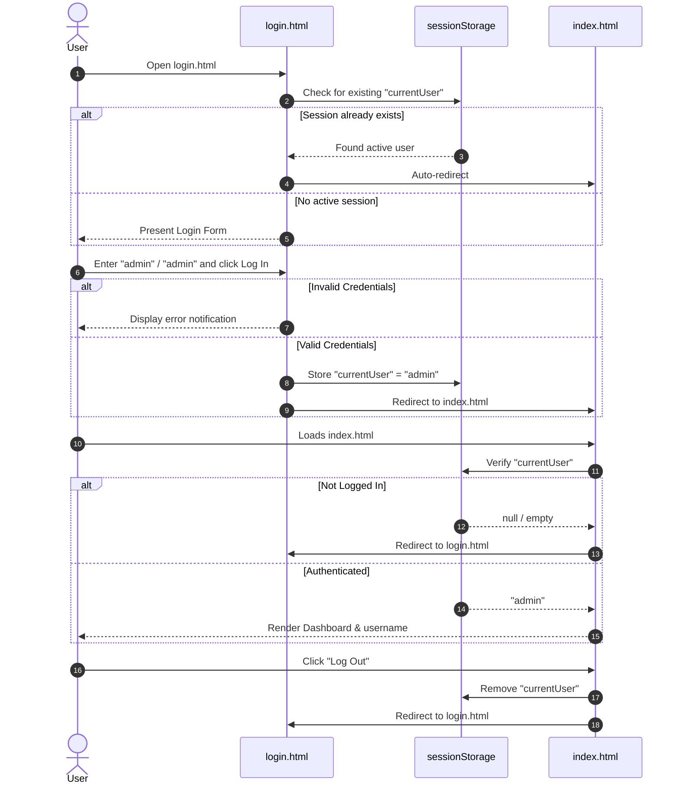

# Authentication Application Guide & Architecture

This document provides architectural diagrams and step-by-step instructions for building a client-side authentication flow with `login.html` and `index.html` without embedding raw HTML code.

---

## 🏗️ Application Architecture & Flow Diagram

### 1. High-Level System Architecture



### 2. User Authentication State Flow



---

## 📋 Specifications & Credentials

- **Default User ID:** `admin`
- **Default Password:** `admin`
- **Session Storage Key:** `currentUser`

---

## 📝 Step-by-Step Instructions to Build `login.html`

### Step 1: Initialize Document Setup
- Set the document type to standard HTML5.
- Add standard document metadata: character encoding (`UTF-8`), viewport configuration for responsive devices, and a descriptive title (e.g., "Login - Portal").

### Step 2: Build the User Interface Structure
Assemble the page layout using semantic elements:
1. **Container / Card**: A central container that holds all login components.
2. **Header Section**: A title heading (e.g., "Welcome Back") and a brief descriptive subtitle.
3. **Alert Banner**: An error message container with a unique ID (`errorMessage`), initially hidden, used to notify users of invalid credentials.
4. **Form Element**: An HTML form containing:
   - **User ID Field**: A text input with a corresponding label, a unique ID (`username`), placeholder text, required validation attribute, and autocomplete disabled.
   - **Password Field**: A password-masked input with a corresponding label, a unique ID (`password`), placeholder text, and required validation attribute.
   - **Submit Action**: A submit button with a unique ID (`loginButton`) and clear call-to-action text (e.g., "Log In").
5. **Helper / Hint Note**: A subtle footer note indicating the default test credentials for reviewers.

### Step 3: Apply Visual Styling (CSS)
- **Base Layout**: Use Flexbox on the body to center the card both vertically and horizontally across the full viewport height (`100vh`).
- **Color Palette**: Implement a modern dark or sleek neutral palette (e.g., slate/navy backgrounds with bright accents).
- **Card Aesthetics**: Apply rounded corners, soft box shadows, and subtle borders.
- **Input Styling**: Ensure full-width inputs with adequate padding, readable font sizes, rounded corners, and clear focus outlines.
- **Button Styling**: Add interactive hover and active transition states to give tactile feedback on click.
- **Error State**: Style the error alert with soft red background tints, subtle border, and clear text color to stand out when triggered.

### Step 4: Implement Client-Side Behavior (JavaScript)
1. **Session Pre-Check**:
   - At script initialization, query `sessionStorage` for the key `currentUser`.
   - If present, immediately redirect the browser to `index.html` to prevent already logged-in users from seeing the login form.
2. **Form Submission Interception**:
   - Attach a `submit` event listener to the login form.
   - Call the event method to prevent the default form submission (preventing page refresh).
3. **Input Extraction & Trimming**:
   - Extract the values from both the username and password inputs.
   - Strip leading/trailing whitespace using trim.
4. **Credential Verification**:
   - Compare the entered values against the constants: `admin` and `admin`.
5. **Success Handling**:
   - Hide the error alert if previously shown.
   - Save the username into `sessionStorage` under the key `currentUser`.
   - Redirect to `index.html` via `window.location.href`.
6. **Failure Handling**:
   - Display the error alert banner to notify the user of invalid input.

---

## 📝 Step-by-Step Instructions to Build `index.html`

### Step 1: Initialize Document Setup
- Set the document type to standard HTML5.
- Add viewport configuration, UTF-8 charset, and a title (e.g., "Dashboard - Home").

### Step 2: Build the Dashboard Layout
1. **Top Navigation Bar**:
   - Brand or application title on the left.
   - User profile area on the right containing:
     - A username placeholder element with a unique ID (`headerUsername`).
     - A logout button with a unique ID (`logoutBtn`).
2. **Main Content Container**:
   - A centered welcome card with:
     - A visual status indicator (e.g., a green active dot and "Logged In" badge).
     - A personalized welcome heading containing a dynamic username span (`displayUsername`).
     - A summary paragraph describing successful access.

### Step 3: Apply Visual Styling (CSS)
- **Page Structure**: Configure a column Flexbox layout taking full viewport height with a dark background.
- **Navigation Bar**: Fixed or sticky top bar with border separation, padding, and space-between alignment for brand and user controls.
- **Logout Button**: Use a distinct danger/red accent color with hover and press effects.
- **Welcome Card**: Styled similarly to the login card with padding, rounded borders, and subtle elevation.

### Step 4: Implement Client-Side Behavior (JavaScript)
1. **Route Guard (Authentication Gate)**:
   - Read the `currentUser` value from `sessionStorage`.
   - If `currentUser` is null, empty, or undefined:
     - Immediately redirect to `login.html` via `window.location.href`.
2. **Dynamic User Display**:
   - If the user is authenticated, locate the header and content username placeholders.
   - Populate their text content with the extracted `currentUser` value.
3. **Logout Flow**:
   - Attach a `click` event listener to the logout button.
   - Inside the handler, remove the `currentUser` item from `sessionStorage`.
   - Redirect the user back to `login.html`.

---

## 🧪 Testing & Verification Checklist

1. **Direct Navigation Test**:
   - Attempt to open `index.html` directly without logging in.
   - **Expected Result**: Immediate bounce back to `login.html`.
2. **Failed Login Test**:
   - Enter arbitrary credentials (e.g., `guest` / `1234`).
   - Click "Log In".
   - **Expected Result**: Page stays on `login.html` and the error alert becomes visible.
3. **Successful Login Test**:
   - Enter `admin` as User ID and `admin` as Password.
   - Click "Log In".
   - **Expected Result**: Seamless redirect to `index.html`; username `admin` is displayed.
4. **Session Persistence Test**:
   - Refresh `index.html` while logged in.
   - **Expected Result**: Remains on `index.html` with `admin` still shown.
5. **Logout Test**:
   - Click "Log Out" on `index.html`.
   - **Expected Result**: Session cleared, navigated back to `login.html`.
6. **Post-Logout Access Test**:
   - Use browser Back button or navigate to `index.html` after logging out.
   - **Expected Result**: Promptly redirected to `login.html`.

---

## 🎭 Automated Playwright Testing & Automatic Browsing

All tests are automated using Playwright to eliminate manual login and validation.

### Test Suite (`tests/auth.spec.js`)
- **TC1 (Form Rendering)**: Validates input elements, labels, and hidden error state on `login.html`.
- **TC2 (Invalid Credentials)**: Tests validation rejection and error banner visibility for invalid credentials.
- **TC3 (Automated Login & Browse)**: Automatically enters `admin`/`admin`, clicks log in, asserts redirection to `index.html`, and verifies authenticated dashboard elements without manual action.
- **TC4 (Route Protection)**: Asserts that unauthenticated access to `index.html` bounces back to `login.html`.
- **TC5 (Logout Lifecycle)**: Automates logging in, clicking logout, and asserts session cleanup and redirection.

### Running Automated Tests
- **Run all automated tests (Headless)**:
  ```bash
  npm test
  ```
- **Run tests in visible headed browser**:
  ```bash
  npm run test:headed
  ```
- **Launch interactive UI runner**:
  ```bash
  npm run test:ui
  ```
- **Run automated live login & browsing demo**:
  ```bash
  npm run browse
  ```
